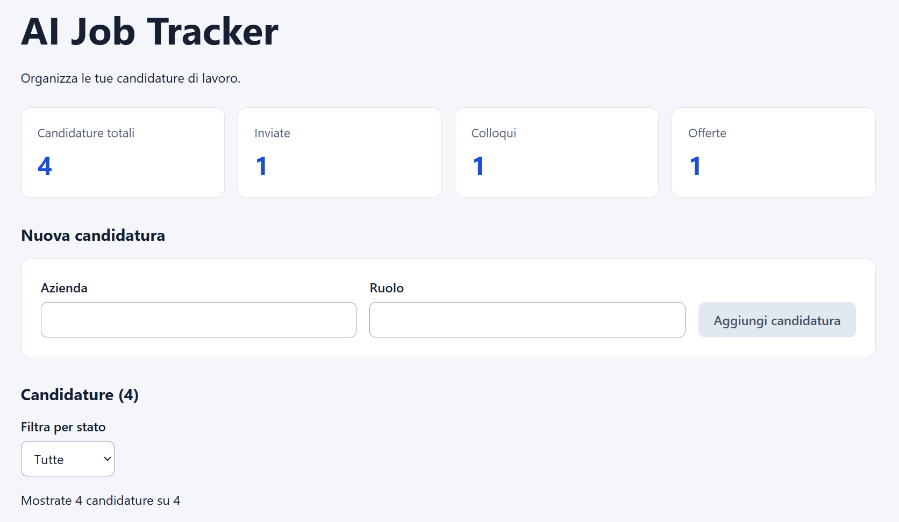

# AI Job Tracker

Applicazione web per organizzare le candidature di lavoro,
sviluppata con React, TypeScript e Vite.

## Demo online

[Prova AI Job Tracker](https://albanz27.github.io/ai-job-tracker/)

## Anteprima

## Funzionalità

- Inserimento di candidature con azienda e ruolo.
- Modifica dello stato della candidatura.
- Filtro per stato.
- Statistiche delle candidature.
- Eliminazione con conferma.
- Salvataggio locale tramite localStorage.
- Interfaccia responsive.

## Avvio locale

Requisiti: Node.js e npm.

Dopo aver clonato il repository:

npm ci
npm run dev

Aprire l'indirizzo mostrato nel terminale.

## Verifiche

npm run lint
npm run build

## Scelte tecniche

TypeScript descrive la struttura delle candidature.
I dati caricati dal browser vengono anche validati durante
l'esecuzione.

Le candidature sono gestite con lo stato React.
Statistiche e risultati del filtro vengono calcolati dalla
lista, evitando stati duplicati.

Il salvataggio viene eseguito dalle azioni di inserimento,
modifica ed eliminazione.

## Limiti attuali

I dati sono salvati nel browser: non vengono sincronizzati
tra dispositivi. Non sono presenti backend o autenticazione.

L'integrazione AI è prevista, ma non ancora implementata.

## Evoluzioni previste

- Backend FastAPI e API REST.
- Database PostgreSQL.
- Autenticazione.
- Generazione di domande da colloquio tramite AI.
- Test automatici e deployment.
